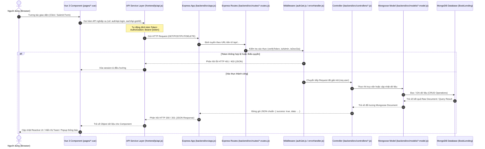

# TÀI LIỆU TỔNG QUAN KIẾN TRÚC HỆ THỐNG QUẢN LÝ MƯỢN TRẢ SÁCH
**BOOK LENDING SYSTEM (MEVN STACK ARCHITECTURE OVERVIEW)**

Tài liệu này tổng hợp toàn bộ hiện trạng kiến trúc kỹ thuật, công nghệ, cấu trúc thư mục, cơ chế bảo mật và luồng xử lý dữ liệu của dự án. Mọi thông tin, phiên bản thư viện và tên tệp tin đều được trích xuất trực tiếp từ mã nguồn thực tế của hệ thống.

---

## 1. Tổng Quan Kiến Trúc Hệ Thống

### 1.1. Mô hình tổng thể
Hệ thống được phát triển theo kiến trúc **Client–Server phân tách độc lập (Decoupled Architecture)** giao tiếp với nhau thông qua **RESTful API** trao đổi dữ liệu định dạng JSON:
- **Client (Frontend)**: Ứng dụng Single Page Application (SPA) xây dựng bằng **Vue.js 3** kết hợp **Vite**, chạy độc lập trên máy chủ phát triển tại cổng **5173** (`http://localhost:5173`).
- **Server (Backend)**: Máy chủ dịch vụ API xây dựng bằng **Node.js** và **Express**, xử lý nghiệp vụ, xác thực và phân quyền, lắng nghe tại cổng **5000** (`http://localhost:5000/api`).
- **Database (Cơ sở dữ liệu)**: Hệ quản trị cơ sở dữ liệu NoSQL **MongoDB** lưu trữ dữ liệu tại máy chủ cục bộ cổng **27017** (`mongodb://127.0.0.1:27017/BookLending`).

### 1.2. Sơ đồ luồng xử lý yêu cầu (Request/Response Lifecycle)

Sơ đồ Mermaid dưới đây mô tả hành trình khép kín của một yêu cầu từ người dùng trên trình duyệt đến cơ sở dữ liệu MongoDB và ngược lại:



---

## 2. Bảng Tổng Hợp Công Nghệ & Thư Viện Đang Sử Dụng

### 2.1. Phía Máy Chủ (Backend)
Các thư viện được ghi nhận chính xác theo `backend/package.json`:

| Tên công nghệ / Thư viện | Phiên bản thực tế | Vai trò cụ thể trong dự án này |
| :--- | :--- | :--- |
| **Node.js** | Runtime Environment | Nền tảng thực thi JavaScript phía máy chủ. |
| **express** | `^4.21.2` | Framework web cốt lõi, tiếp nhận HTTP Request, điều hướng (routing) và quản lý pipeline Middleware. |
| **mongoose** | `^8.23.0` | Thư viện Object Data Modeling (ODM) cho MongoDB, quản lý kết nối, định nghĩa Schema, kiểu dữ liệu, index và validation. |
| **jsonwebtoken** | `^9.0.3` | Tạo (sign), mã hóa và xác minh (verify) chữ ký JSON Web Token (JWT) phục vụ phiên đăng nhập không trạng thái (stateless auth). |
| **bcryptjs** | `^3.0.3` | Băm mật khẩu một chiều có kèm Salt (`bcrypt.hash(..., 10)`) và đối soát đăng nhập an toàn cho Độc giả và Nhân viên. |
| **cors** | `^2.8.5` | Middleware cấu hình chính sách Cross-Origin Resource Sharing, cho phép Frontend tại `localhost:5173` gọi API vào backend. |
| **dotenv** | `^17.3.1` | Tải các biến môi trường từ tệp `.env` vào đối tượng `process.env` khi ứng dụng khởi chạy. |

### 2.2. Phía Giao Diện (Frontend)
Các thư viện được ghi nhận chính xác theo `frontend/package.json`:

| Tên công nghệ / Thư viện | Phiên bản thực tế | Vai trò cụ thể trong dự án này |
| :--- | :--- | :--- |
| **vue** | `^3.5.13` | Framework SPA hiện đại (Vue 3), quản lý vòng đời component, phản ứng dữ liệu (Reactivity System) và render giao diện. |
| **vue-router** | `^4.5.0` | Thư viện điều hướng trang đơn (SPA Router) dùng chế độ Hash (`createWebHashHistory`), điều phối Navigation Guards. |
| **bootstrap** | `^5.3.3` | Thư viện CSS cung cấp hệ thống phân chia lưới (Grid System), layout cơ bản và các class tiện ích hiển thị. |
| **vite** *(devDependencies)* | `^6.0.7` | Công cụ đóng gói (bundler) và máy chủ phát triển cực nhanh dựa trên Native ES Modules và Hot Module Replacement (HMR). |
| **@vitejs/plugin-vue** *(devDependencies)* | `^5.2.1` | Plugin chính thức của Vite hỗ trợ phân tích cú pháp và biên dịch các tệp Single File Component (`.vue`). |
| **Tailwind CSS** *(CDN Engine)* | Engine CDN runtime | Tải engine tiện ích kết hợp tệp cấu hình thiết kế thương hiệu `frontend/js/tailwind-config.js` để định kiểu giao diện nhất quán. |

---

## 3. Kiến Trúc Backend (Node.js + Express)

### 3.1. Cây thư mục thực tế của `backend/`
```text
backend/
├── .env                  # Tệp lưu cấu hình biến môi trường thực tế (PORT, MONGO_URI, JWT_SECRET)
├── .env.example          # Tệp mẫu hướng dẫn cấu hình môi trường
├── package.json          # Quản lý định nghĩa dependencies và các scripts chạy backend
├── package-lock.json     # Khóa phiên bản chính xác của các gói thư viện
├── server.js             # Điểm khởi đầu (Entry Point) của toàn bộ dịch vụ Backend
├── test_api.js           # Bộ kiểm thử tự động toàn diện 20 kịch bản API
├── run_tests.js          # Script thực thi chạy test
└── src/
    ├── app.js            # Khởi tạo Express App, middleware cơ sở, nạp routes & error handler
    ├── config/           # Cấu hình hệ thống
    │   ├── auth.config.js# Cấu hình khóa bí mật và hạn dùng JWT
    │   └── db.config.js  # Kết nối cơ sở dữ liệu MongoDB qua Mongoose
    ├── controllers/      # Tầng điều khiển xử lý logic nghiệp vụ (MVC - Controller)
    │   ├── auth.controller.js
    │   ├── docGia.controller.js
    │   ├── gioHang.controller.js
    │   ├── nhanVien.controller.js
    │   ├── nhaXuatBan.controller.js
    │   ├── phieuMuon.controller.js
    │   ├── phieuPhat.controller.js
    │   ├── sach.controller.js
    │   └── tacGia.controller.js
    ├── middlewares/      # Tầng middleware can thiệp trước khi vào controller
    │   ├── authJwt.js    # Xác thực Token, kiểm tra quyền Admin/DocGia
    │   └── errorHandler.js# Bắt lỗi 404 và xử lý lỗi ngoại lệ toàn cục
    ├── models/           # Định nghĩa Schema & Model cơ sở dữ liệu (MVC - Model)
    │   ├── docGia.model.js
    │   ├── gioHang.model.js
    │   ├── nhanVien.model.js
    │   ├── nhaXuatBan.model.js
    │   ├── phieuMuon.model.js
    │   ├── phieuPhat.model.js
    │   ├── sach.model.js
    │   └── tacGia.model.js
    ├── routes/           # Tầng định tuyến URL (Routing)
    │   ├── auth.routes.js
    │   ├── docGia.routes.js
    │   ├── gioHang.routes.js
    │   ├── index.js      # Bộ gom định tuyến tổng hợp gắn tiền tố /api
    │   ├── nhanVien.routes.js
    │   ├── nhaXuatBan.routes.js
    │   ├── phieuMuon.routes.js
    │   ├── phieuPhat.routes.js
    │   ├── sach.routes.js
    │   └── tacGia.routes.js
    └── utils/            # Tiện ích bổ trợ hệ thống
        └── seeder.js     # Tự động nạp dữ liệu danh mục & tài khoản mẫu ban đầu
```

### 3.2. Cơ chế khởi động Server (`server.js` và `app.js`)
1. **Khởi tạo và cấu hình (`app.js`)**:
   - Sử dụng `cors()` mở quyền truy cập cho tất cả các method `['GET', 'POST', 'PUT', 'DELETE', 'OPTIONS']` cùng headers `['Content-Type', 'Authorization']`.
   - Cấu hình parser: `express.json()` và `express.urlencoded({ extended: true })`.
   - Nạp tuyến gốc `/` cung cấp thông điệp chào mừng và endpoint kiểm tra tình trạng máy chủ `/api/health`.
   - Gắn toàn bộ cụm router từ `src/routes/index.js` vào đường dẫn gốc `/api`.
   - Đăng ký middleware xử lý tuyến đường không tồn tại (`notFound`) và bắt lỗi tập trung (`errorHandler`) ở cuối pipeline.
2. **Quy trình kích hoạt tuần tự (`server.js`)**:
   - `dotenv.config()` đọc tệp `.env`.
   - `await connectDB()` kích hoạt hàm kết nối Mongoose tới URI MongoDB. Nếu thất bại, tiến trình dừng ngay lập tức (`process.exit(1)`).
   - `await seedData()` kiểm tra cơ sở dữ liệu. Nếu các bảng danh mục hoặc tài khoản quản trị chưa có, hệ thống tự động chèn dữ liệu mẫu.
   - `app.listen(PORT)` bắt đầu mở cổng lắng nghe kết nối HTTP.

### 3.3. Xử lý lỗi tập trung (`errorHandler.js`)
Hệ thống chuẩn hóa phản hồi lỗi thông qua 2 hàm middleware:
- **`notFound`**: Khi người dùng gọi vào một route không tồn tại trong backend, hàm tạo ra lỗi `Error` với mã trạng thái `404` và đẩy qua `next(error)`.
- **`errorHandler`**: Bắt mọi lỗi phát sinh từ controller hoặc middleware. Tự động kiểm tra `process.env.NODE_ENV`: nếu đang ở môi trường `production`, thuộc tính `stack` (dấu vết lỗi) sẽ bị ẩn đi để bảo mật hệ thống; đồng thời luôn trả về cấu trúc JSON chuẩn:
  ```json
  {
    "success": false,
    "message": "Nội dung lỗi chi tiết",
    "stack": null
  }
  ```

### 3.4. Cơ chế tự động nạp dữ liệu mẫu (`seeder.js`)
Khi khởi động lần đầu với cơ sở dữ liệu trống, `seeder.js` tự động kiểm tra số lượng bản ghi (`countDocuments === 0`) và khởi tạo:
- Danh mục 4 Nhà xuất bản (`NXB-01` đến `NXB-04`).
- Danh mục 7 Tác giả (`TG-01` đến `TG-07`).
- Danh mục 40 cuốn sách kỹ thuật (đồng bộ từ `frontend/js/books.json`).
- Tài khoản Cán bộ thư viện quản trị mặc định: `admin@thuvien.edu.vn` / mật khẩu `admin123` (được băm bằng bcrypt).
- Tài khoản Độc giả mẫu: `docgia@thuvien.edu.vn` / mật khẩu `docgia123` kèm giỏ hàng rỗng liên kết.

---

## 4. Kiến Trúc Cơ Sở Dữ Liệu (MongoDB & Mongoose)

### 4.1. Danh sách các Collection / Model Mongoose
Hệ thống gồm **8 Collections chính** tương ứng với 8 tệp Model trong `backend/src/models/`:

1. **`DocGia` (`docGia.model.js`)**: Lưu thông tin bạn đọc. Gồm: `maDG` (unique, index), `tenDG`, `ngaySinhDG`, `emailDG` (unique, index), `matKhauDG`, `trangThaiDG`, `gioiTinhDG`, `hoLot`, `dienThoai`, `diaChi`, `timestamps: true`.
2. **`NhanVien` (`nhanVien.model.js`)**: Lưu thông tin cán bộ thư viện / quản trị viên. Gồm: `maNV` (unique, index), `tenNV`, `ngaySinhNV`, `emailNV` (unique, index), `matKhauNV`, `chucVuNV`, `gioiTinhNV`, `soDienThoai`, `diaChi`, `trangThaiNV`, `timestamps: true`.
3. **`NhaXuatBan` (`nhaXuatBan.model.js`)**: Danh mục nhà xuất bản. Gồm: `maNXB` (unique, index), `tenNXB`, `diaChi`, `timestamps: true`.
4. **`TacGia` (`tacGia.model.js`)**: Danh mục tác giả. Gồm: `maTG` (unique, index), `tenTG`, `timestamps: true`.
5. **`Sach` (`sach.model.js`)**: Danh mục đầu sách. Gồm: `maSach` (unique, index), `tenSach`, `loai`, `namXB`, `donGia`, `soLuong`, `trangThaiS`, `maNXB` (ref `NhaXuatBan`), `maTG` (ref `TacGia`), `hinhAnh`, `moTa`, `luotMuon`, `timestamps: true`.
6. **`GioHang` (`gioHang.model.js`)**: Giỏ sách của từng độc giả. Gồm: `maGH` (unique), `maDG` (unique, ref `DocGia`), `tongSoLuong`, mảng sub-documents `chiTiet: [chiTietGioHangSchema]`, `timestamps: true`.
7. **`PhieuMuon` (`phieuMuon.model.js`)**: Phiếu theo dõi mượn trả sách. Gồm: `maPM` (unique, index), `maDG` (ref `DocGia`), `tenDG`, `emailDG`, `maNV` (ref `NhanVien`), `tenNV`, `ngayMuon`, `hanTra`, `ngayTraTT`, `trangThaiPM`, `tongTienSach`, mảng sub-documents `chiTiet: [chiTietPhieuMuonSchema]`, `timestamps: true`.
8. **`PhieuPhat` (`phieuPhat.model.js`)**: Phiếu xử lý vi phạm / phạt độc giả. Gồm: `maPP` (unique, index), `maPM` (ref `PhieuMuon`), `maDG` (ref `DocGia`), `tenDocGia`, `emailDocGia`, `maNV` (ref `NhanVien`), `tenNV`, `ngayLapPhat`, `trangThaiPP`, `tongTienPhat`, mảng sub-documents `chiTiet: [chiTietPhieuPhatSchema]`, `timestamps: true`.

### 4.2. Chiến lược thiết kế NoSQL: Tham chiếu (Reference) vs Nhúng (Embedded)

Cơ chế tổ chức dữ liệu kết hợp tối ưu giữa tính toàn vẹn và hiệu năng truy vấn:

| Loại quan hệ | Chiến lược NoSQL áp dụng | Lý do thiết kế cụ thể trong dự án |
| :--- | :--- | :--- |
| **`Sach` $\to$ `NhaXuatBan`, `TacGia`** | **Reference** (Tham chiếu qua `maNXB`, `maTG`) | Một tác giả hoặc NXB có thể liên kết với hàng ngàn đầu sách. Nếu nhúng vào từng cuốn sách sẽ dẫn đến dư thừa dữ liệu lớn; khi đổi tên NXB sẽ phải cập nhật hàng loạt document sách. |
| **`PhieuMuon` / `PhieuPhat` $\to$ `DocGia`, `NhanVien`** | **Reference** (Tham chiếu qua `maDG`, `maNV`) | Độc giả và Nhân viên là những thực thể độc lập, có vòng đời tài khoản riêng. Phiếu mượn chỉ lưu mã tham chiếu kèm snapshot tên để truy vấn nhanh mà không làm phình to dữ liệu. |
| **`GioHang` $\to$ `DocGia`** | **Reference** (Quan hệ 1–1 sở hữu qua `maDG`) | Đảm bảo tính độc lập giữa tài khoản người dùng và tài nguyên giỏ hàng, cho phép tải thông tin độc giả mà không cần kéo theo toàn bộ dữ liệu giỏ. |
| **`chiTiet` trong `GioHang`** | **Embedded Sub-document** (`chiTietGioHangSchema`) | Danh sách sách trong giỏ luôn được truy xuất cùng lúc với giỏ hàng. Nhúng trực tiếp giúp đọc/ghi giỏ chỉ trong **1 câu truy vấn duy nhất** (`findOne` hoặc `findOneAndUpdate`), đạt hiệu năng cao nhất. |
| **`chiTiet` trong `PhieuMuon`** | **Embedded Sub-document** (`chiTietPhieuMuonSchema`) | Đóng vai trò **Snapshot lịch sử**. Lưu cố định tên sách, đơn giá và số lượng mượn ngay tại thời điểm mượn. Nếu sau này đầu sách trong bảng `Sach` bị đổi giá hay đổi tên, lịch sử mượn trong phiếu vẫn không bị sai lệch. |
| **`chiTiet` trong `PhieuPhat`** | **Embedded Sub-document** (`chiTietPhieuPhatSchema`) | Các khoản mục phạt (tiền phạt, lý do trễ hạn/hư hỏng, số ngày trễ) luôn thuộc về duy nhất một phiếu phạt cụ thể, không cần tái sử dụng ở nơi khác. |

### 4.3. Ràng buộc toàn vẹn nghiệp vụ cài đặt trong code
1. **Chặn xóa ràng buộc khóa ngoại (Foreign Key Protection)**:
   - Trong `nhaXuatBan.controller.js`: Chặn xóa NXB nếu `Sach.countDocuments({ maNXB: nxb.maNXB }) > 0` (trả về HTTP 400 kèm thông báo rõ số lượng sách đang phụ thuộc).
   - Trong `tacGia.controller.js`: Chặn xóa Tác giả nếu `Sach.countDocuments({ maTG: tg.maTG }) > 0` (trả về HTTP 400).
   - Trong `sach.controller.js`: Chặn xóa cuốn sách nếu cuốn sách đó đang nằm trong phiếu mượn có trạng thái `CHO_DUYET` hoặc `DANG_MUON` (trả về HTTP 400).
2. **Cơ chế trừ và hoàn trả tồn kho tự động**:
   - Khi Thủ thư duyệt mượn (`approve` trong `phieuMuon.controller.js`): Hệ thống tự động dùng toán tử `$inc` để **trừ số lượng sách** theo số lượng mượn (`soLuong: -item.soLuongMuon`) đồng thời **tăng lượt mượn** của cuốn sách (`luotMuon: item.soLuongMuon`).
   - Khi Thủ thư xác nhận độc giả đã trả sách (`returnBook`): Tự động cộng hoàn trả số lượng sách về lại kho lưu trữ (`$inc: { soLuong: item.soLuongMuon }`).
3. **Đồng bộ vòng đời Giỏ hàng và Mượn sách**:
   - Khi độc giả đăng ký tài khoản thành công (`auth.controller.js`): Hệ thống tự động khởi tạo ngay một document `GioHang` rỗng mang mã `GH-<maDG>`.
   - Khi độc giả xác nhận gửi yêu cầu mượn sách (`create` trong `phieuMuon.controller.js`): Sau khi tạo thành công phiếu mượn, hệ thống tự động làm sạch giỏ hàng (`chiTiet: [], tongSoLuong: 0`).

---

## 5. Kiến Trúc Frontend (Vue.js)

### 5.1. Cây thư mục thực tế của `frontend/`
```text
frontend/
├── index.html            # Tệp HTML máy chủ nạp ứng dụng, phông chữ và CSS cơ sở
├── package.json          # Quản lý dependencies và scripts của Vue/Vite
├── package-lock.json     # Khóa phiên bản gói frontend
├── vite.config.js        # Cấu hình Vite (plugins, alias '@', dev server port 5173)
├── App.vue               # Root Component hiển thị thẻ <router-view />
├── main.js               # Khởi tạo Vue Application, nạp Router, layout helpers và mount #app
├── css/                  # Tầng định kiểu độc lập (CSS Layer)
│   ├── bootstrap.min.css # CSS Bootstrap 5
│   ├── common.css        # Biến màu, phông chữ, reset và các style dùng chung toàn hệ thống
│   ├── bookManagement.css
│   ├── borrowManagement.css
│   ├── cart.css
│   ├── detailCard.css
│   ├── fineManagement.css
│   ├── fineTicket.css
│   ├── home.css
│   ├── login.css
│   ├── profile.css
│   ├── readerManagement.css
│   └── register.css
├── js/                   # Tầng logic nghiệp vụ, trạng thái & gọi API (Logic Layer)
│   ├── api.js            # Dịch vụ gọi API tập trung (Centralized HTTP Client)
│   ├── common.js         # Thư viện lưu trữ cục bộ, helpers định dạng tiền tệ/ngày tháng, Popups
│   ├── components.js     # Hàm tạo mã HTML dùng chung: getHeader, getFooter, getAdminSidebar...
│   ├── router.js         # Khởi tạo Vue Router và các Navigation Guards
│   ├── tailwind-config.js# Mở rộng bảng màu, phông chữ của hệ thống thiết kế Dark Theme
│   ├── books.json        # Dữ liệu tĩnh dự phòng danh mục sách
│   ├── accounts.json     # Dữ liệu tĩnh dự phòng tài khoản
│   ├── home.js           # Logic xử lý Trang chủ (lọc, phân trang, thêm vào giỏ)
│   ├── bookManagement.js # Logic Quản lý Sách, NXB, Tác giả của Admin
│   ├── borrowManagement.js# Logic Duyệt / Từ chối / Hoàn tất mượn trả
│   ├── cart.js           # Logic Giỏ hàng, tăng giảm số lượng, đặt mượn
│   ├── detailCard.js     # Logic Trang chi tiết sách
│   ├── fineManagement.js # Logic Quản lý danh sách phiếu phạt, xác nhận thu
│   ├── fineTicket.js     # Logic Lập phiếu phạt mới
│   ├── login.js          # Logic Form Đăng nhập
│   ├── profile.js        # Logic Trang cá nhân & lịch sử mượn của Độc giả
│   ├── readerManagement.js# Logic Quản lý Độc giả và Nhân viên
│   └── register.js       # Logic Form Đăng ký độc giả
└── pages/                # Tầng giao diện Single File Components (View Layer)
    ├── BookManagement.vue# Quản lý Sách (Admin)
    ├── BorrowManagement.vue# Quản lý Mượn / Trả (Admin)
    ├── Cart.vue          # Giỏ hàng mượn sách (Client)
    ├── DetailCard.vue    # Chi tiết một cuốn sách (Client/Guest)
    ├── FineManagement.vue# Danh sách Phiếu phạt (Admin)
    ├── FineTicket.vue    # Lập phiếu phạt vi phạm (Admin)
    ├── Home.vue          # Trang chủ danh mục sách (Client/Guest)
    ├── Login.vue         # Màn hình Đăng nhập
    ├── Profile.vue       # Trang cá nhân & lịch sử (Client)
    ├── ReaderManagement.vue# Quản lý Độc giả & Nhân sự (Admin)
    └── Register.vue      # Màn hình Đăng ký
```

### 5.2. Tầng gọi API tập trung (`frontend/js/api.js`)
Toàn bộ hoạt động giao tiếp mạng của Frontend đều thông qua hàm bao bọc `apiRequest(endpoint, options)`:
- **Cấu hình Base URL**: Tự động nhận biến môi trường `import.meta.env.VITE_API_URL`, nếu không có sẽ dùng mặc định `http://localhost:5000/api`.
- **Tự động gắn Token**: Trích xuất token từ `localStorage.getItem('token')` và tự động gắn vào header `Authorization: Bearer <token>` cho mọi request.
- **Xử lý lỗi HTTP tập trung**:
  - **Mã 401 (Unauthorized)**: Khi token hết hạn hoặc không hợp lệ, hệ thống tự động xóa `token`, `user`, `role` khỏi `localStorage` và chuyển hướng trình duyệt về trang đăng nhập `#/login`.
  - **Mã lỗi khác (400, 403, 404, 500)**: Bóc tách thuộc tính `message` hoặc `error` từ JSON phản hồi của Backend, tạo đối tượng `Error` chứa đầy đủ mã `status` và `data` để các Component hiển thị thông báo lỗi trực quan (Popup/Toast) cho người dùng.

### 5.3. Cơ chế định tuyến & Bảo vệ tuyến đường (`frontend/js/router.js`)
Ứng dụng sử dụng cơ chế **Hash Routing** (`createWebHashHistory()`) tương thích với mọi máy chủ tĩnh. Trước mỗi lần chuyển trang (`router.beforeEach`), hệ thống thực hiện kiểm tra phân quyền nghiêm ngặt:

1. **Bảo vệ phân hệ Quản trị (`/admin/...`)**:
   - Nếu chưa có `token`: Chuyển hướng ngay về `#/login`.
   - Nếu có `token` nhưng `role !== 'NHANVIEN'`: Chặn truy cập và chuyển hướng về `#/home`.
2. **Bảo vệ dữ liệu cá nhân (`/cart`, `/profile`)**:
   - Nếu người dùng là khách vãng lai (chưa đăng nhập, không có `token`): Tự động chuyển hướng về `#/login`.
3. **Điều hướng người dùng đã xác thực**:
   - Nếu người dùng đã đăng nhập mà cố tình truy cập vào `#/login` hoặc `#/register`: Hệ thống tự động chuyển hướng Nhân viên vào `#/admin/books` và Độc giả vào `#/home`.
4. **Chế độ Khách vãng lai (Guest Mode)**:
   - Khách chưa đăng nhập chỉ được phép xem Trang chủ (`#/home`) và Chi tiết sách (`#/book/:id`).
   - Nếu khách nhấn "MƯỢN TÀI LIỆU" hoặc "THÊM VÀO GIỎ", Component sẽ chặn lại và kích hoạt Popup yêu cầu đăng nhập.

### 5.4. Lưu trữ phiên làm việc & Đồng bộ dữ liệu giao diện
- **Lưu trữ Session**: Thông tin đăng nhập được lưu trữ an toàn trong `localStorage` gồm 3 mục: `token` (chuỗi JWT), `user` (thông tin người dùng hiện tại dưới dạng chuỗi JSON) và `role` (`'DOCGIA'` hoặc `'NHANVIEN'`).
- **Đồng bộ Header chung**: Hàm `getHeader()` trong `frontend/js/components.js` tự động đọc phiên đăng nhập:
  - Nếu đã đăng nhập: Hiển thị Avatar cùng tên người dùng và số lượng sách trong giỏ.
  - Nếu chưa đăng nhập: Ẩn thông tin cá nhân, hiển thị nút `ĐĂNG NHẬP` và số lượng giỏ hàng là `00`.
- **Đồng bộ số lượng giỏ hàng giữa các trang**: Sử dụng cơ chế Custom Event của trình duyệt:
  ```javascript
  // Phát sự kiện khi thêm/xóa sách trong giỏ:
  window.dispatchEvent(new CustomEvent('cart-updated', { detail: { count: newCount } }));

  // Các trang khác (Home, DetailCard) lắng nghe sự kiện để cập nhật badge Header:
  window.addEventListener('cart-updated', this.onCartUpdated);
  ```

---

## 6. Cơ Chế Bảo Mật, Xác Thực & Phân Quyền

### 6.1. Luồng Đăng ký & Đăng nhập
- **Đăng ký tài khoản Độc giả (`POST /api/auth/register`)**:
  1. Kiểm tra tính duy nhất của `emailDG` trong Collection `DocGia`.
  2. Băm mật khẩu bằng thuật toán an toàn `bcrypt.hash(matKhauDG, 10)`.
  3. Tự động sinh mã độc giả `DG-xxxx`.
  4. Tạo document `DocGia` mới kèm document `GioHang` rỗng tương ứng.
  5. Ký và trả về mã JWT Token chứa thông tin độc giả.
- **Đăng nhập một điểm duy nhất (Single Login Endpoint - `POST /api/auth/login`)**:
  1. Tiếp nhận `email` và `password`.
  2. Kiểm tra trước trong bảng `DocGia` theo `emailDG`. Nếu tìm thấy, xác thực mật khẩu bằng `bcrypt.compare`. Nếu khớp, cấp token với quyền `role: 'DOCGIA'`.
  3. Nếu không có trong `DocGia`, kiểm tra tiếp trong bảng `NhanVien` theo `emailNV`. Nếu khớp mật khẩu, cấp token với quyền `role: 'NHANVIEN'`.
  4. Nếu không tìm thấy hoặc sai mật khẩu, trả về lỗi HTTP 401 chuẩn.

### 6.2. Cấu trúc Payload của JWT Token
Token được ký bằng thuật toán HMAC SHA256 với khóa bí mật `JWT_SECRET` và có thời hạn hiệu lực `24h` (`JWT_EXPIRES_IN`):
```json
{
  "id": "673f1a2b3c4d5e6f7a8b9c0d",
  "code": "DG-0001",
  "role": "DOCGIA",
  "email": "docgia@thuvien.edu.vn",
  "name": "Nguyễn Văn A",
  "iat": 1732176000,
  "exp": 1732262400
}
```
*(Đối với nhân viên, thuộc tính `code` mang giá trị `NV-xxxx` và `role` mang giá trị `'NHANVIEN'`)*.

### 6.3. Tầng Middleware kiểm soát quyền truy cập (`authJwt.js`)
Các API cần bảo vệ được gắn các middleware kiểm tra nghiêm ngặt:
- **`verifyToken`**: Đọc header `Authorization`. Nếu thiếu header trả về lỗi HTTP 403; cắt bỏ tiền tố `'Bearer '`, giải mã token bằng `jwt.verify`. Nếu token hết hạn hoặc giả mạo, trả về HTTP 401; nếu hợp lệ, gán payload đã giải mã vào `req.user` và chuyển sang bước kế tiếp.
- **`isAdmin`**: Kiểm tra `req.user.role === 'NHANVIEN'`. Nếu không phải nhân viên/thủ thư, từ chối với lỗi HTTP 403: *"Yêu cầu quyền Quản trị viên / Thủ thư (NHANVIEN) để thực hiện thao tác này!"*.
- **`isDocGia`**: Kiểm tra `req.user.role === 'DOCGIA'`. Nếu không phải độc giả, từ chối với HTTP 403.

---

## 7. Kiểm Thử & Triển Khai (Testing, Build & Deploy)

### 7.1. Bảng tổng hợp các tập lệnh thực thi (NPM Scripts)

#### Tại thư mục gốc (`package.json`):
- `npm run dev`: Chạy máy chủ phát triển Frontend (`npm --prefix frontend run dev`).
- `npm run build`: Biên dịch Frontend ra gói sản phẩm tĩnh (`npm --prefix frontend run build`).
- `npm run preview`: Chạy thử nghiệm bản build tĩnh của Frontend.

#### Tại thư mục Backend (`backend/package.json`):
- `npm start`: Khởi động máy chủ API sản phẩm bằng lệnh `node server.js`.
- `npm run dev`: Chạy máy chủ phát triển tự động tải lại khi sửa mã nguồn (`nodemon server.js`).
- `npm run seed`: Chạy độc lập script nạp dữ liệu mẫu ban đầu (`node src/utils/seeder.js`).
- `npm test`: Thực thi toàn bộ bộ kiểm thử tự động API Backend (`node test_api.js`).

#### Tại thư mục Frontend (`frontend/package.json`):
- `npm run dev`: Khởi chạy máy chủ phát triển Vite tại `http://localhost:5173`.
- `npm run build`: Thực hiện đóng gói ứng dụng bằng lệnh `vite build`.
- `npm run preview`: Khởi chạy máy chủ xem trước các tệp đã build trong thư mục `dist/`.

### 7.2. Cơ chế bộ kiểm thử tự động Backend (`backend/test_api.js`)
Backend sở hữu bộ kiểm thử tích hợp (Integration Test) viết hoàn toàn bằng module mạng chuẩn `http` của Node.js, không phụ thuộc framework test bên ngoài, kiểm tra tuần tự **20 kịch bản nghiệp vụ cốt lõi**:
1. **Kiểm tra sức khỏe hệ thống (Health Check)**: Gọi `GET /api/health` đảm bảo API online.
2. **Kiểm tra đăng nhập thất bại**: Gửi sai mật khẩu, đảm bảo trả về mã HTTP 401.
3. **Đăng nhập quản trị viên**: Đăng nhập bằng `admin@thuvien.edu.vn`, lấy JWT token của `NHANVIEN`.
4. **Đăng nhập độc giả**: Đăng nhập bằng `docgia@thuvien.edu.vn`, lấy JWT token của `DOCGIA`.
5. **Kiểm tra bảo vệ phân quyền (Authorization)**: Độc giả gọi API quản trị nhân viên `GET /api/nhanvien`, đảm bảo bị chặn bằng mã HTTP 403.
6. **Kiểm duyệt token rỗng**: Gọi endpoint yêu cầu quyền mà không truyền header `Authorization`, đảm bảo trả về mã HTTP 403.
7. **Kiểm thử danh mục Sách**: Lấy danh sách toàn bộ sách (`GET /api/sach`) và Top 10 sách mượn nhiều (`GET /api/sach/top10`).
8. **Kiểm thử chi tiết sách**: Lấy thông tin cuốn sách theo mã định danh.
9. **Kiểm thử danh mục NXB & Tác giả**: Truy vấn danh sách Nhà xuất bản và Tác giả.
10. **Kiểm thử nghiệp vụ Giỏ hàng**: Thêm sách vào giỏ (`POST /api/giohang/add`), kiểm tra giỏ (`GET /api/giohang`), cập nhật số lượng (`PUT /api/giohang/update`).
11. **Kiểm thử Đăng ký mượn sách**: Độc giả tạo phiếu mượn (`POST /api/phieumuon`), kiểm tra giỏ hàng tự động được làm rỗng sau khi đặt mượn.
12. **Kiểm thử xem lịch sử mượn**: Độc giả lấy danh sách phiếu mượn của chính mình (`GET /api/phieumuon/my`).
13. **Kiểm thử Thủ thư duyệt mượn**: Nhân viên duyệt phiếu mượn (`PUT /api/phieumuon/:id/duyet`), kiểm tra trạng thái chuyển sang `DANG_MUON` và tồn kho sách tự động bị trừ.
14. **Kiểm thử Xác nhận trả sách**: Nhân viên xác nhận trả (`PUT /api/phieumuon/:id/tra`), kiểm tra trạng thái chuyển sang `DA_TRA` và sách được hoàn lại kho.
15. **Kiểm thử Hủy phiếu mượn**: Độc giả hủy yêu cầu khi đang ở trạng thái `CHO_DUYET`.
16. **Kiểm thử Quản lý Phiếu phạt**: Lập phiếu phạt vi phạm (`POST /api/phieuphat`), lấy chi tiết phiếu phạt (`GET /api/phieuphat/:id`) và Thủ thư xác nhận thu tiền (`PUT /api/phieuphat/:id/xac-nhan-thu`).
17. **Kiểm thử Ràng buộc toàn vẹn khóa ngoại**: Cố tình xóa NXB đang có sách liên kết, đảm bảo Backend phát hiện và chặn lại với mã lỗi HTTP 400.
18. **Kiểm thử Ràng buộc mượn trả**: Cố tình xóa cuốn sách đang có người mượn, đảm bảo Backend chặn lại với mã lỗi HTTP 400.
19. **Kiểm thử Khóa / Mở khóa độc giả**: Quản trị viên kích hoạt hoặc khóa tài khoản bạn đọc (`PUT /api/docgia/:id/toggle-lock`).
20. **Kiểm thử CRUD Nhân viên**: Tạo, cập nhật và xóa tài khoản nhân viên thư viện.

### 7.3. Quy trình đóng gói sản phẩm Frontend (Production Build)
- Khi thực thi lệnh `npm --prefix frontend run build`, trình biên dịch Vite sẽ:
  1. Phân tích cây phụ thuộc từ `frontend/main.js` và `frontend/index.html`.
  2. Biên dịch toàn bộ các Single File Component (`.vue`) thành mã JavaScript chuẩn ES6 tối ưu hóa.
  3. Ghép nối và nén nhỏ (minify) các tệp mã nguồn và bảng kiểu CSS (`css/*.css`).
  4. Đánh mã băm (content hash) vào tên file kết quả (ví dụ: `Home-j57O8g7C.js`, `index-Dv6kZrGO.css`) nhằm kiểm soát bộ nhớ đệm (cache-busting) trên trình duyệt người dùng.
  5. Xuất toàn bộ tài nguyên sẵn sàng triển khai (Production Assets) vào thư mục `frontend/dist/`.
